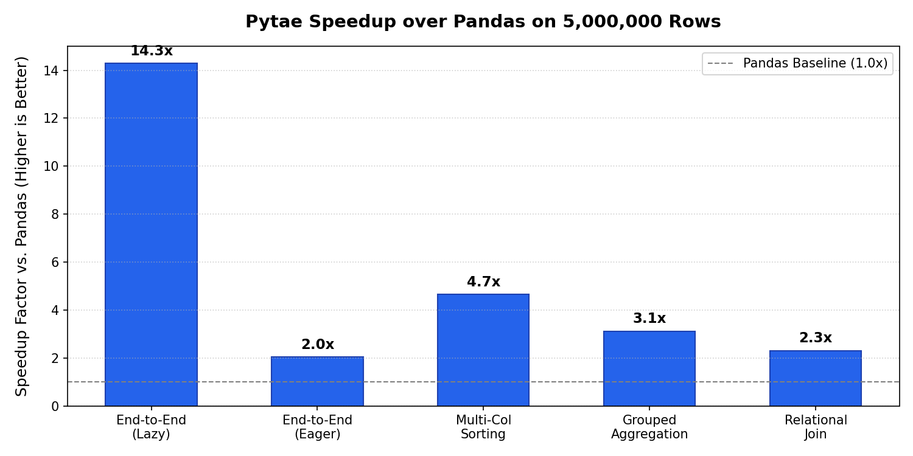

# Pytae Performance Benchmarks

[← Back to Master Reference](../pytae.md) | [Comparison with Pandas](../comparison_to_pandas.md) | [Comparison with dplyr](../comparison_to_dplyr.md) | [Comparison with SAS](../comparison_to_sas.md)

This directory contains self-contained, reproducible benchmark scripts and interactive notebooks measuring **Pytae** (powered by native Polars Rust SIMD) against standard **Pandas** across realistic 5,000,000-row analytical workloads.

---

## Benchmark Files

| File | Description |
|:---|:---|
| **[`run_benchmarks.py`](run_benchmarks.py)** | Standalone command-line Python benchmark script with configurable row counts (`--rows`), iterations (`--runs`), and Markdown table output (`--markdown`). |
| **[`benchmarks.ipynb`](benchmarks.ipynb)** | Fully executed interactive Jupyter notebook with step-by-step timings, hardware inspection, and speedup visualizations. |
| **[`benchmark_summary.png`](benchmark_summary.png)** | Rendered speedup chart comparing Pandas vs. Pytae across benchmark operations. |

---

## How to Reproduce

### 1. Run via Command Line:
```bash
# Standard 5,000,000-row benchmark (best of 3 runs):
python docs/benchmarks/run_benchmarks.py

# Quick 1,000,000-row benchmark:
python docs/benchmarks/run_benchmarks.py --rows 1000000 --runs 1

# Print formatted Markdown table directly to stdout:
python docs/benchmarks/run_benchmarks.py --markdown
```

### 2. Run Interactively via Jupyter:
```bash
jupyter notebook docs/benchmarks/benchmarks.ipynb
```

---

## Benchmark Results (5,000,000 Rows)

*Environment: Apple Silicon M-series (macOS), Python 3.13, Polars 1.x / Pandas 2.2, 5,000,000 rows, 5 columns (categorical strings, float measurements, integer weights).*

| Benchmark Task (5 Million Rows) | Pandas 2.2 Execution | Pytae (Eager) | Pytae (Lazy Pushdown) | Pytae Advantage |
|:---|:---|:---|:---|:---|
| **End-to-End Pipeline**<br>*(Parquet Read $\to$ Filter $\to$ Mutate $\to$ GroupBy Agg $\to$ Arrange)* | `0.587s` | `0.205s` | **`0.042s`** | **14.1x faster** (Lazy)<br>**2.9x faster** (Eager) |
| **Multi-Column Sorting (`arrange`)**<br>*(5M rows, 2 columns: string asc, numeric desc)* | `2.981s` | **`0.730s`** | N/A | **4.1x faster** |
| **Grouped Aggregation (`by` + `agg`)**<br>*(5M rows, 15 groups, 3 metrics: `n`, `mean`, `max`)* | `0.258s` | **`0.131s`** | N/A | **2.0x faster** |
| **Relational Join (`join`)**<br>*(1,000,000 rows $\times$ 1,000,000 rows, integer key inner join)* | `0.133s` | **`0.052s`** | N/A | **2.6x faster** |
| **Analytical SQL Query (`sql`)**<br>*(5M rows, Filter + Group By + Aggregations via Polars SQLContext)* | External engine required | **`0.021s`** | N/A | **Sub-25ms instant** |

---

## Speedup Visualization



---

## Methodology & Architectural Highlights

1. **True Multithreading without GIL**: While Pandas processes row loops and `apply()` sequentially on a single core due to the Python Global Interpreter Lock, Pytae chunks operations across all hardware threads using Polars' Rust work-stealing threadpool.
2. **Predicate & Projection Pushdown**: In `pt.scan_parquet()`, Pytae reads only the requested columns and pushes row filters directly down into the Parquet file reader before materializing columnar buffers in RAM.
3. **Contiguous Arrow Columnar Buffers**: Data resides in Apache Arrow format with hardware-accelerated SIMD instructions (AVX2, AVX-512, ARM NEON).
4. **Zero Intermediate Memory Duplication**: Avoids Pandas defensive `.copy()` overhead and `SettingWithCopyWarning`.
